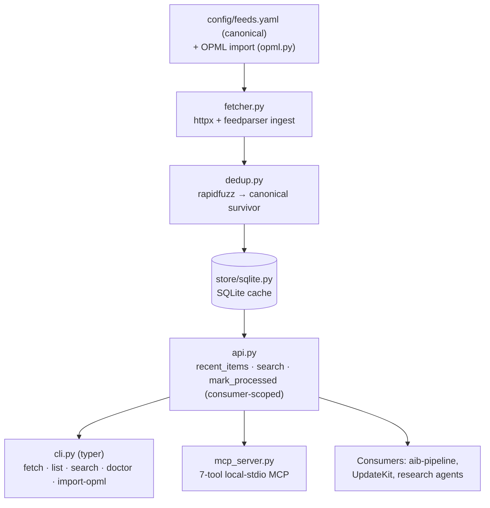

# aib-reader

**Self-owned RSS aggregation substrate for the ASTGL ecosystem.**

A small Python library (plus a thin local-stdio MCP server) that ingests RSS/Atom
feeds, deduplicates across them, and answers "what's new on these sources?" queries
by category, time window, and keyword. Built because Feedly gates its developer API
behind an enterprise tier — so we own the aggregation layer instead.

> Status: **v0.0.1.** The library (SQLite store, async fetcher, dedup), the CLI, and the
> MCP server are implemented. See [`tasks/todo.md`](tasks/todo.md) for the build sequence,
> open gates, and the design doc referenced there for the full rationale.

Not just for one project. The same store is queried by `aib-pipeline` (the daily
AI-news briefing), and is meant to be reused by UpdateKit, ASTGL article research,
and any Claude Code agent that needs "what changed on these feeds?"



<!-- archify:start -->
### System map


Interactive: [`docs/diagrams/aib-reader.architecture.html`](docs/diagrams/aib-reader.architecture.html)
— search, trace routes, compare roles. Source of truth is the typed IR
[`aib-reader.architecture.json`](docs/diagrams/aib-reader.architecture.json); edit that, never the HTML.
<!-- archify:end -->

---

## The contract (the part other projects depend on)

`aib-reader` is a **library first**. Consumers import it directly — no MCP transport,
no running server:

```python
from aib_reader import fetch_recent_items, mark_processed, Item

# Newest-first, dedupped, filtered to a category and time window.
items: list[Item] = fetch_recent_items(since="24h", limit=100, category="AI World")

# ... a consumer does its work ...

# Consumer-scoped cursor: marking these processed does NOT hide them from a
# different consumer (e.g. UpdateKit or a research agent).
mark_processed([i.id for i in items], consumer="aib-pipeline")
```

`since` accepts a suffix duration (`"24h"`, `"7d"`, `"2w"`) or an ISO-8601 timestamp.

## CLI

```bash
uv run aib-reader fetch            # poll all active feeds, store + dedup new items (-c <category> to filter)
uv run aib-reader list             # list configured feeds (title, categories, URL)
uv run aib-reader search "Anthropic"   # keyword search across stored items
uv run aib-reader doctor           # per-feed health; --deactivate retires dead feeds
uv run aib-reader import-opml <export.opml>   # convert a Feedly OPML export to config/feeds.yaml
uv run aib-reader version
```

## MCP (for interactive Claude Code / agents)

A local-stdio MCP server exposes the same functions as seven tools. Each tool maps
1:1 to a library function (`mcp_server.py` imports `api.py`, never the reverse — the
MCP SDK stays out of the library import path so the cron stays zero-overhead):

| MCP tool | Library function |
|---|---|
| `list_feeds()` | `list_feeds()` |
| `recent_items(limit, since, category)` | `fetch_recent_items(since, limit, category)` |
| `search_items(query, limit)` | `search_items(query, limit)` |
| `mark_processed(item_ids, consumer)` | `mark_processed(item_ids, consumer)` |
| `add_feed(url, category)` | `add_feed(url, category)` |
| `remove_feed(url)` | `remove_feed(url)` |
| `poll_feeds(categories)` | `poll_feeds(categories)` |

Register it user-scope in `~/.claude.json`:

```json
{
  "mcpServers": {
    "aib-reader": { "type": "stdio", "command": "aib-reader-mcp", "args": [], "env": {} }
  }
}
```

## Install (local dev)

```bash
uv sync --extra dev          # create venv + install deps
uv run aib-reader --help
uv run pytest
```

The feed list is `config/feeds.yaml` (generated from a Feedly OPML export; see
`config/feeds.yaml.example`). The SQLite store lives at `~/.aib-reader/store.db`.
Override paths and fetch tunables with `AIB_READER_DB_PATH`, `AIB_READER_FEEDS_CONFIG`,
`AIB_READER_USER_AGENT`, `AIB_READER_FETCH_CONCURRENCY`, `AIB_READER_FETCH_TIMEOUT`, and
`AIB_READER_FIRST_FETCH_HORIZON_DAYS` (defaults in `aib_reader/config.py`).

## Project structure

| Path | Purpose |
|---|---|
| `aib_reader/` | Library: `api.py` (public contract), `models.py`, `fetcher.py`, `dedup.py`, `opml.py`, `config.py`, `cli.py`, `mcp_server.py` |
| `aib_reader/store/` | `Store` protocol and the SQLite backend |
| `config/` | `feeds.yaml.example` (the real `feeds.yaml` is gitignored) |
| `scripts/` | MCP smoke test and the robustness-gate sampler (launchd plist) |
| `tests/` | pytest suite with fixture OPML and ugly-feed XML |
| `docs/`, `tasks/`, `sessions/` | Horizon evaluation and research, build plan, session logs |

## Design

Decisions (library-first, aggregation-query-only v1, all feeds ingested, from-scratch
SQLite behind a swappable `Store` interface, reference-not-adopt Horizon, consumer-scoped
cursors) are recorded in the approved design doc and mirrored in
[`tasks/todo.md`](tasks/todo.md).

## License

MIT
